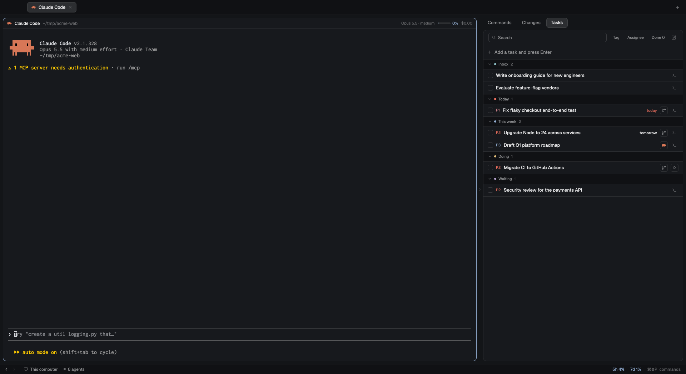

# Agent Maestro

A [Herdr](https://herdr.dev) layout for running many Claude Code agents from one task list: tasks that start, jump to and resume their agents, a Cmd+K task switcher, back/forward agent history, and each agent's model, context and cost in its pane header.

## Install

Ask an agent in Herdr: "add herdr.dev/layouts/fearenales/agent-maestro". Or by hand:

1. Copy `layouts/agent-maestro.json` to `~/.config/herdr-app/layouts/` and each folder in `mods/` to `~/.config/herdr-app/mods/`.
2. Merge `keys.json` into `~/.config/herdr-app/keys.json` (Cmd+K, Cmd+[ / Cmd+], Cmd+Shift+Enter).
3. Optional, for the usage figures: install `extras/claude-statusline.py` as your Claude Code status line (instructions at the top of the file).
4. Switch to it: Cmd+Shift+L, or `herdr-app do layout.switch --name agent-maestro`.

Settings (repositories folder, Jira, GitHub organisation, your name) are at the top of `mods/maestro-tasks/main.js`.

See [RECIPE.md](RECIPE.md) for everything it does and how it is built.
