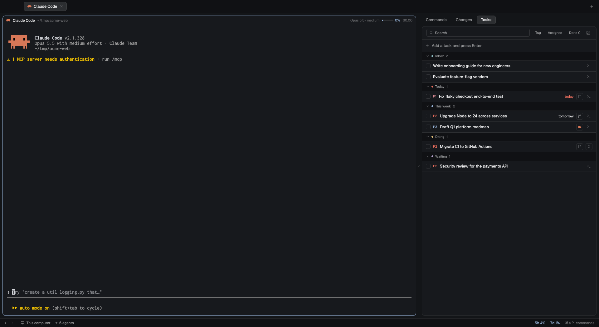

# Agent Maestro

A Herdr layout for running many Claude Code agents from one task list. The left sidebar is gone: the terminal of the agent you are working with fills the window, and a right-hand column holds your tasks, the shell commands your agents run, and a git diff viewer. Every task can start, jump to or resume its own agent; Cmd+K is a task switcher that puts agents waiting for you first; Cmd+[ and Cmd+] go back and forward through the agents you visited; each agent's model, context and cost sit in its pane header and the account's usage limits in the status bar.



## What you see

Left to right, top to bottom:

- **Sidebar** (Herdr's spaces and agents lists, 268px): hidden by default. Cmd+B shows it.
- **Tab bar** (42px, Herdr's `tabs` mod) across the top of the work area. It leaves room for the macOS window buttons on its own.
- **Main area**: the shown tab's panes. Each pane has a 30px header on top, 10px corner radius, 8px gap, a 1px `border` frame and a 1px `accent` frame when focused.
  - **Pane header** (`maestro-pane-usage`): program icon, name, folder; for a Claude Code agent, on the right: `Opus 5.5 - medium`, a 36x5px context bar with its percentage, and the session cost (`$26.33`), all 11px in `dim`. The bar and percentage are blue below 70%, yellow from 70%, magenta from 90% (`ansi4`, `ansi3`, `ansi5`). Figures older than 15 minutes are drawn at half opacity. Hover shows the full numbers. Hovering the header shows split, zoom and close buttons, as Herdr's own.
- **Collapse handle**: a 10px strip with a small chevron between the main area and the right column. Click hides or shows the column.
- **Right column** (`side`, 560px, 320-1200px, resizable by dragging its left edge): a 28px tab strip (Commands, Changes, Tasks) over a stack of three panels, each a 10px-rounded box with a 1px `border`:
  - **Commands** (`maestro-commands`): a feed of the shell commands Claude Code agents ran, newest first: agent name, time, duration, the command in a raised mono box (accent text), its output below (red tint when it failed). Running commands show a spinner and stream their output. "All agents" / "Focused" filter, "Clear".
  - **Changes** (`maestro-review`): a git diff viewer for the focused pane's repository: scope menu (uncommitted, branch vs base, outgoing, incoming, single commit), base-branch picker, per-file fold, "reviewed" checkboxes, a file tree column when wide enough.
  - **Tasks** (`maestro-tasks`): described below.
- **Status bar** (28px): `<` `>` history arrows (52px, `maestro-agent-history`), then `This computer`, branch, agent count, and on the right the 5-hour and 7-day usage limits (`5h 4%  7d 34%`, same blue/yellow/magenta ramp; from 70% the reset time is shown, `-> 1h19m`) and the palette hint.

### The Tasks panel

- Header row: a search box (fills the width), `Tag` and `Assignee` filter menus, `Done N` toggle, an edit icon that opens `~/tasks.md` in the default text editor.
- "Add a task and press Enter" input.
- Groups in this order, each with a 28px header in `chrome`, a chevron to fold it, a 6px coloured dot and a count: Inbox (cyan `ansi6`), Today (`blocked`), This week (blue `ansi4`), Doing (`working`), Waiting (magenta `ansi5`), Done (green `ansi2`, only when shown or searching), Other agents (`dim`).
- A task is one 13px line: checkbox, priority (`P1` red, `P2` amber, `P3` blue), title (truncated), then right-aligned: due label (`overdue 2d` red, `today` amber, `tomorrow`, a weekday, or `Dec 2`), a 22px bordered badge per link kind (a branch icon for GitHub PRs/issues, the orange Claude logo for claude.ai artifacts), and the agent badge.
- **Agent badge** (22px bordered square): working = spinner; needs you = `!` on an amber tint; finished = filled dot; idle = hollow dot; tab closed but resumable = dotted circle; closed without a session = link icon. A task without an agent shows a `>_` start button instead.
- Clicking a task goes to its agent (resumes it if its tab was closed; a task without an agent expands instead). Hovering a task shows a small chevron-down in its left margin, 12px wide and left of the checkbox; clicking it expands or collapses the task, and it stays visible while expanded. An expanded task shows its repository, people, tags and links as small tags, then an editor: title, status buttons, priority buttons, due date (text with shortcuts plus a calendar), repository picker, assignees / stakeholders / tags with suggestions, links, notes, and a button row: Start agent (or Unlink agent), Link focused tab, Delete, Save.
- The task whose agent you are in is highlighted with the `selected` background (also in Other agents).
- **Other agents** lists agents no open task links to, by their Claude Code session title, with a `+` to make a task for one.

## How it behaves

- **The task file** is `~/tasks.md`, a Markdown checklist anyone can edit (you, an editor, an agent). The panel re-reads it every 2 seconds and writes it only with compare-and-swap; changes queue in order. Format:

  ```
  - [ ] Title <!-- herdr:tab=<id> -->
    status: inbox | today | this week | doing | waiting
    priority: P1 | P2 | P3
    due: YYYY-MM-DD
    repository: my-repo or team/my-repo
    assignees: Ann, Bob
    stakeholders: security team
    tags: infra, security
    links: https://..., SEC-123, repo#45, #45
    session: <Claude Code session id, kept by the panel>
    any other indented line is a note
  ```
  New tasks get a header comment documenting this schema.
- **Start agent** (`>_` or the editor button): saves pending edits, then opens a new space named after the task, in the task's repository (`<REPOS>/<repository>`) or a new `~/tmp/YYYY-MM-DD-<slug>/`, runs `claude` with the task (title, fields, notes) as its first message, and links the task to the new tab. Nothing changes the task's status by itself.
- **Agent badge click**: jumps to the agent; on a closed tab with a recorded session, runs `claude --resume <session>` in the folder the session started in, in a new space, and relinks.
- **Session tracking**: every 10 seconds the panel records the Claude Code session running in each linked tab into the task's `session:` field.
- **Ticking a task done** while its agent's tab is open asks "Mark done and close its agent?" (warns if it is working or waiting for you); Confirm marks it done and closes the tab (and the space, if it was its only tab). The session stays, so it can be resumed.
- **Delete** asks first (Herdr's `confirm` dialog).
- **Due date** accepts `today`, `tomorrow`, `fri`, `+3d`, `2w`, `1m`, `next week` or `YYYY-MM-DD`; impossible dates are refused.
- **Search** matches every typed word, in any order, across title, notes, status, fields and the linked agent's space and tab; while searching, done tasks are included and folded groups open; Esc clears it.
- **Cmd+K** opens the task switcher (the same mod as a popup at the top, 640px wide): open tasks only, ordered: agents waiting for you and agents that just finished (each by newest state change), agents that are working (latest started first), then everything else by when you last viewed it (stayed on its agent for 2 seconds or more, picked it here, or expanded it in the panel; passing through an agent does not count). Each row: group dot, priority, title, due, link icons, agent status. Up/Down select, Enter goes to the agent (resumes a closed one, starts one if there is none), Esc or Cmd+K closes. With no match, a "New task: <text>" row creates the task in Inbox and starts its agent.
- **Cmd+[ / Cmd+]**: back and forward through visited agents, like a browser (100 visits, closed agents skipped, a new visit drops the forward history; while a step is landing, focus changes are ignored for up to 1.5 seconds). The status-bar arrows do the same; their tooltip names the target.
- **Cmd+Shift+Enter** shows or hides the right column (Herdr's `pane.zoom` default lives on this key; it moves to the header button).

## Built from

- **Layout** `layouts/agent-maestro.json`: root row = `sidebar` column (hidden; Herdr's `workspace-chrome`, `spaces`, `agents`) + `work` column. `work` = `tabs` block (42px, `tabs` mod), `work-body` row (padding 8, gap 4), `status-row` row (28px, not resizable). `work-body` = `main-wrap` row (not resizable: `main` tab block with the pane frame and `maestro-pane-usage` header, `side-toggle` block 10px with `maestro-side-tabs` props `{role: "toggle"}`) + `side` column (560px, gap 6) + hidden `panel` (Herdr's `files` / `changes`). `side` = `side-tabs` block (28px, `maestro-side-tabs`) + `side-body` stack (`commands`, `review`, `tasks` blocks). `status-row` = `history` block (52px, `maestro-agent-history`) + `status` block (`maestro-status-usage`).
- **Mods**:
  - `maestro-tasks`: the panel, and the Cmd+K switcher when opened as an overlay (its `mod.json` has `overlay: {kind: popup, at: top, offset: 40, width: 640, height: 0.6}`; `props().overlay` switches the view). Uses `spaces`, `agents`, `focused`, `exec` (`mkdir`, `herdr-app do space.new`, `find`, `open`, `sh` + `grep` on transcripts), `hc get --json`, `readTextFile` / `writeTextFile`, `openOverlay` (Herdr's `confirm`), `run` (`tab.select`, `tab.close`), `shared` / `setShared` (`maestro.viewed`), `nextCommand` (`delete`, `done-close` from the confirm dialog). Reads `~/.claude/sessions/<pid>.json` and `~/.claude/projects/*/<session>.jsonl`.
  - `maestro-commands`: runs its `feed.py` (python3) every 1-2 seconds; it maps each agent terminal to its Claude Code session (`hc get` -> pid -> `~/.claude/sessions`) and parses the session transcripts (and sub-agents) for Bash tool calls, results and live output files.
  - `maestro-review`: runs read-only `git` (`--no-optional-locks`) in the focused pane's repository; watches it with `watchFolder`.
  - `maestro-side-tabs`: the tab strip and collapse handle; `layout.select`, `layout.toggle`.
  - `maestro-agent-history`: tracks `focused().agent`, `agent.focus` to step; writes `tab:<id>` view times to `shared("maestro.viewed")`.
  - `maestro-pane-usage`, `maestro-status-usage`: copies of Herdr's `pane` and `workspace-status` with the usage figures added; they read `~/.claude/herdr/<session>.json` and `latest.json`.
- **Claude Code status line** (`extras/claude-statusline.py`): writes those snapshot files on every status refresh (atomic rename), and prints nothing inside Herdr unless there is a warning.
- **Shipped assets used**: `mods/workspace-chrome/spinner.svg`, `mods/files/chevron-*.svg`. Icons in the mods are Lucide; `maestro-tasks/icons/claude.svg` is Herdr's Claude Code icon.

## Watch out

- An event handler's `cx` cannot redraw after an `await`: every change that writes the file runs inside `cx.spawn`, or the panel silently stops updating.
- `.child(null)` throws during render and Herdr keeps the stale frame: return `div()` for "nothing".
- `on_mouse_down_out` only sees presses inside the mod's own block; pickers also close when their input blurs (with a 200ms delay so a click on a row still lands).
- Mods cannot import files from another mod's folder, which is why the switcher is the tasks mod opened as a popup.
- A popup sizes to its content: the switcher list gets an explicit height (rows x 34px, up to 12).
- A fixed-width block beside a resizable column blocks dragging: the 10px handle shares `main-wrap` with the terminals so the column's edge can move.
- Don't call `setShared` from render; agent-history notes the focus in render and saves views on a 500ms timer (after 2 seconds on an agent, then every 5 seconds while you stay).
- A back/forward step redraws before the focus moves: without ignoring the focus it is leaving, that redraw records a bogus visit and the list drifts.
- `<mod>.<command>` reaches shown copies only, so the history mod lives in the always-visible status bar.
- Settings at the top of `maestro-tasks/main.js`: `REPOS` (default `~/workspace`), `JIRA` and `GITHUB` (empty: Jira keys and `repo#45` stay plain text), `ME` (your name, hidden from assignee tags), `AGENT` (`["claude"]`).
- The usage figures need the status line snapshot; without it the pane header and limits stay empty and everything else works.
- Commands, Other agents, session tracking and resume assume Claude Code and read its local files; remote machines are skipped.

## Done when

- `herdr-app check` passes for all seven mods and `layout.switch {name: "agent-maestro"}` shows the window above with no errors in `herdr-app status`.
- Adding "Test" in the Tasks panel creates `~/tasks.md` with the schema header and `- [ ] Test` / `status: inbox`.
- `>_` on a task opens a space named after it running `claude` with the task as first message, and the task line gains `<!-- herdr:tab=... -->`; within 10 seconds it also gains `session:`.
- Closing that space turns the badge into a dotted circle; clicking it reopens the conversation with its history.
- Cmd+K lists open tasks; typing an unknown title shows "New task: ..." and Enter creates and starts it.
- Cmd+[ after focusing two agents returns to the first.
- With the status line installed, a Claude Code pane header shows model, context % and cost, and the status bar shows `5h` and `7d`.
